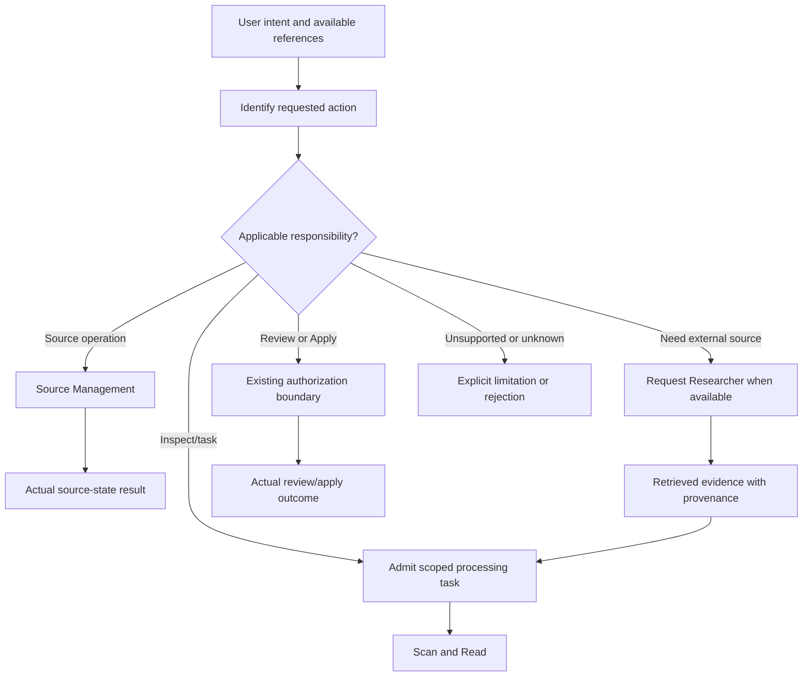
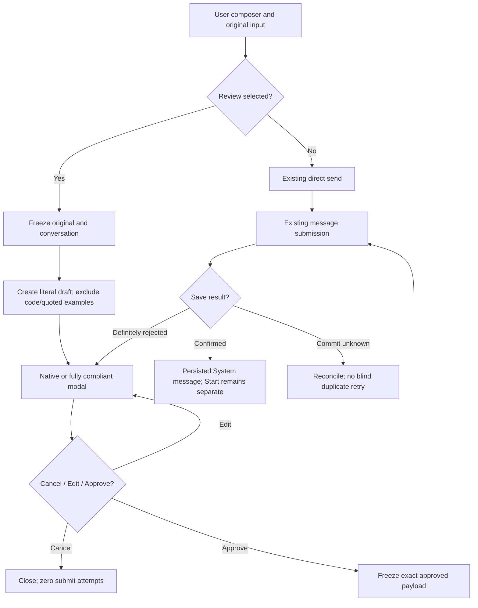
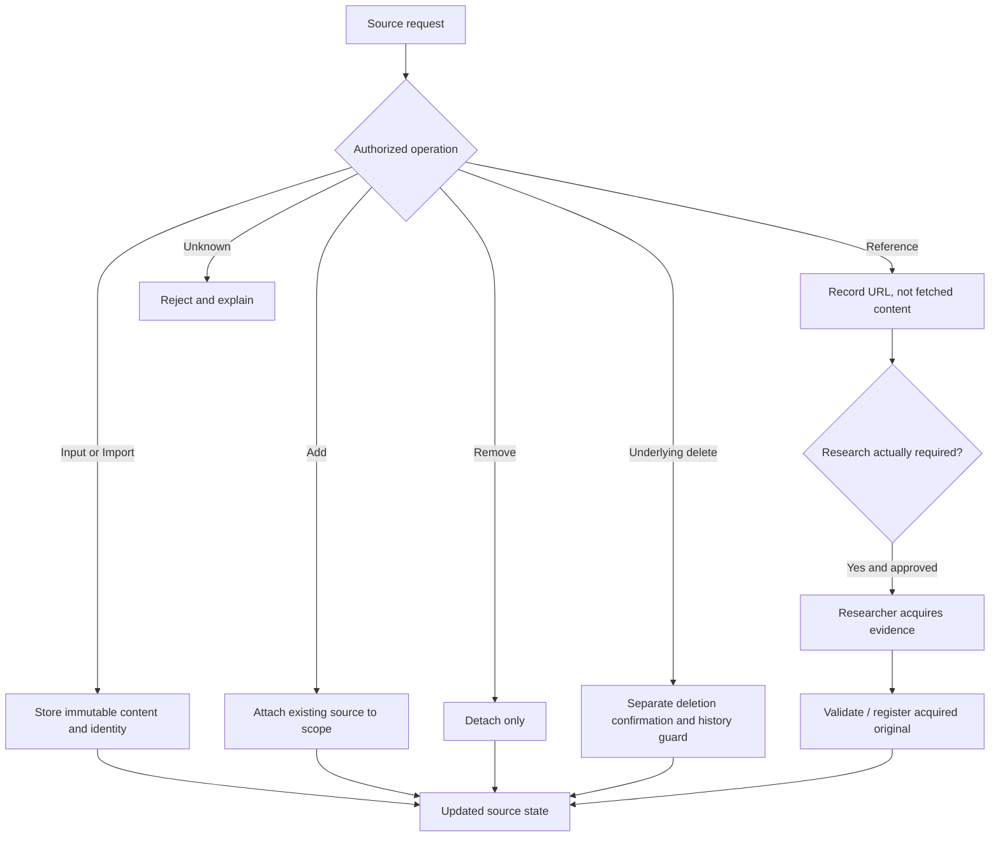
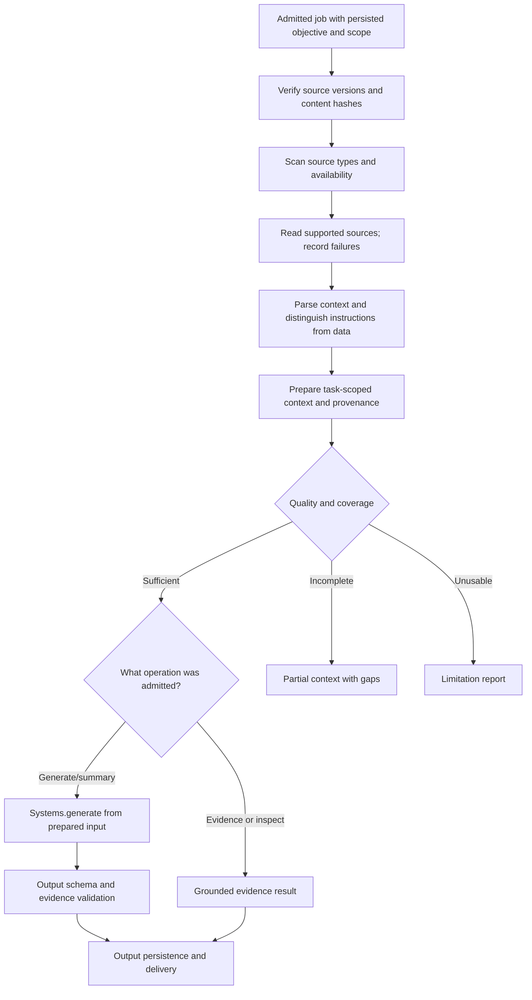
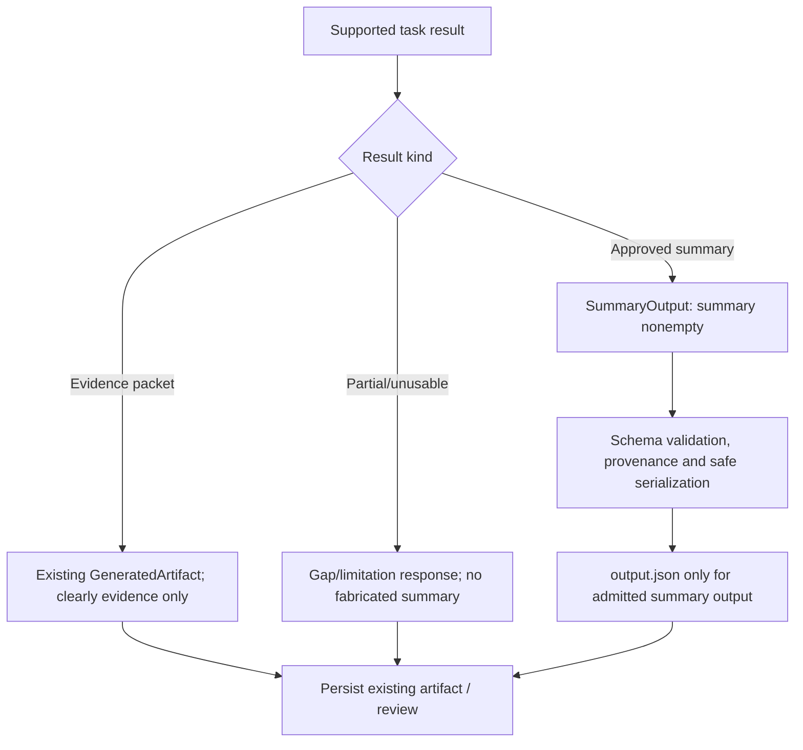
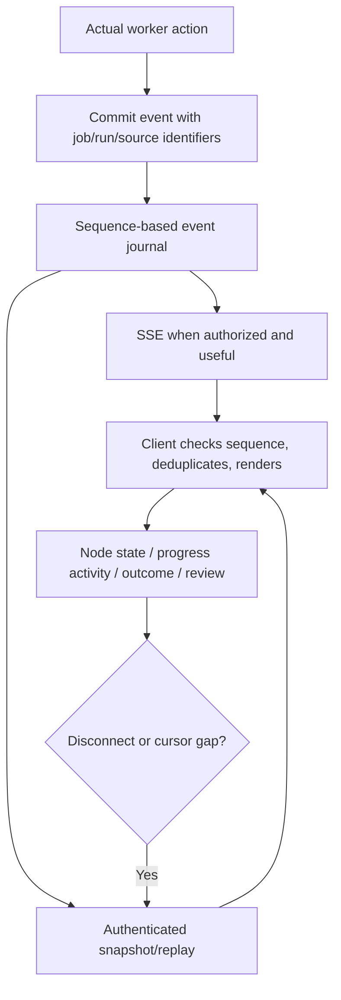
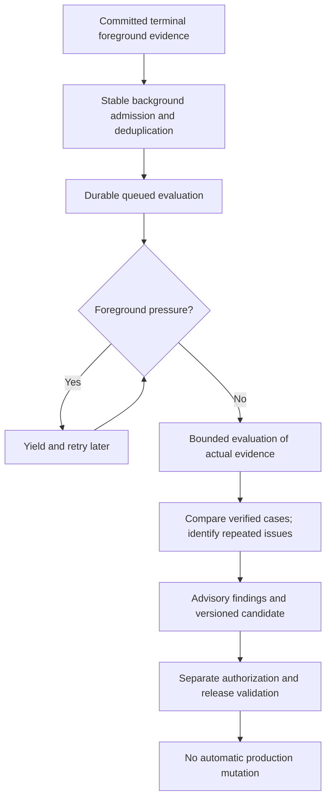
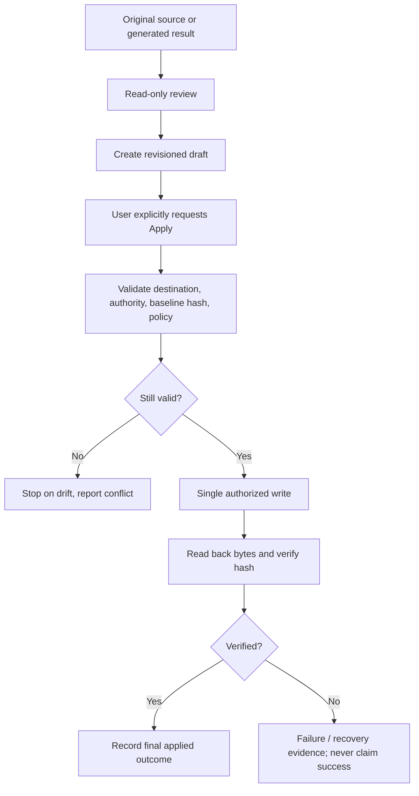
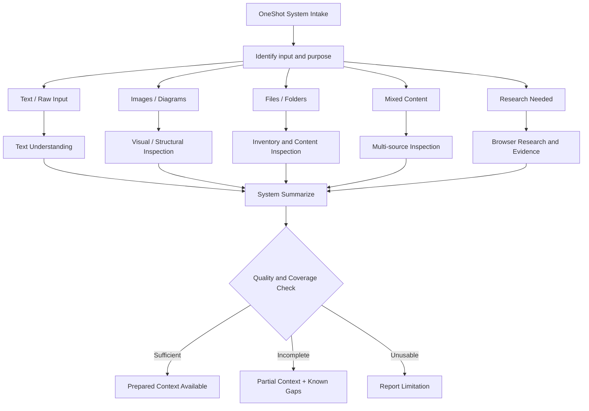
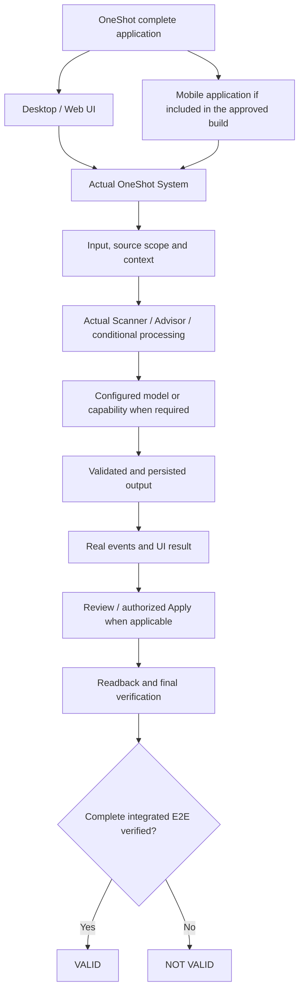

# OneShot — Workflow-to-Code Map

**Purpose:** Pin the eight approved OneShot workflow diagrams to the exact code that implements them, so each diagram is independently verifiable against the live source. Diagrams are reproduced verbatim from `OneShot_Named_Diagrams_vNext_2026-10-10.md`; the "Implemented by" tables below are the authoritative anchors.

**Scope:** Documentation + conformance check only. No behavior change. The sibling test `tests/test_workflow_conformance.py` fails if any anchor drifts (missing symbol, wrong signature, wrong endpoint path).

---

## D-01 — Request Classification and Responsibility Dispatch

| Node | Implemented by |
|---|---|
| Identify requested action | `frontend/app.js` → `sendSystem()`, `startJob()`; `systems/contracts.py` → `SourceAction` discriminated union, `JobCreate.operation` |
| Source Management branch | `systems/operations.py` → `source_action()` |
| Admit scoped processing task | `systems/operations.py` → `admit()` |
| Researcher branch | `capabilities/researcher/tools/web_browser.py` → `validate_url()`; `capabilities/researcher/tools/web_extraction.py` → `extract_text()` |
| Authorization boundary (Review/Apply) | `systems/apply.py` → `prepare()`, `confirm()` |
| Explicit limitation or rejection | `fastapi.HTTPException` 4xx raised by `source_action` / `admit` with `from None` chaining |
| Scan and Read | `capabilities/scanner/scanner.py` → `inspect()` (invoked by `systems/operations.py:Worker.execute()` at node `source_access` → `scanner`) |

## D-02 — Optional Pre-Send Review

| Node | Implemented by |
|---|---|
| Review selected? | `frontend/index.html` → `#presend-enabled` checkbox; `frontend/app.js` → `sendSystem()` branch |
| Freeze original + extract literal draft | `frontend/presend.js` → `createPreSendController.open()`, `draftContextSummary()` (headings/colon-labels only, fenced code and block-quotes excluded) |
| Modal | `frontend/index.html` → `<dialog id="presend-dialog">` (native); keyboard trap and focus return in `frontend/app.js:renderPreSendReview()` |
| Cancel → zero submits | `frontend/presend.js` → `.cancel()` resets controller without calling `send` |
| Approve → exact payload | `frontend/presend.js` → `.approve()`: snapshots `payload` before `await send(…)`, asserts `saved.content === approved.payload` |
| Direct send branch | `frontend/app.js` → `sendSystem()` else branch; `api.message()` |
| Server save | `systems/api.py` → `POST /api/conversations/{cid}/messages` → `systems/operations.py:add_message()` (idempotency key honoured) |
| Reconcile — no blind retry | `frontend/presend.js` → `requestKey` only rotates after `attempted=true` **and** the user edits the summary; otherwise the same idempotency key is reused |
| Tests | `tests/test_presend_message.py`, `tests/e2e_presend.py`, `frontend/tests/presend.test.mjs` |

## D-03 — Source Management and Research Boundary

| Node | Implemented by |
|---|---|
| Authorized operation discriminator | `systems/contracts.py` → `SourceAction = Union[InputSource, ImportSource, AddSource, ReferenceSource, RemoveSource, DeleteSource]` with `Field(discriminator=action)` |
| Input / Import → immutable store | `systems/operations.py:source_action()` → `store.files.put(raw)` (SHA-256 addressed); `systems/file_store.py:FileStore.put()` |
| Add → attach existing | `systems/operations.py:source_action()` → `INSERT OR IGNORE INTO source_links` under one writer lock |
| Reference → URL only | `systems/operations.py` → `validate_url()` from `capabilities/researcher`; row kind=`reference`, sha256=NULL |
| Remove → detach only (never delete bytes) | `systems/operations.py:source_action()` → `DELETE FROM source_links WHERE …`; underlying `sources` row untouched |
| Delete → separate authority | `systems/contracts.py:DeleteSource` requires `confirm_delete: Literal[True]` |
| Reject unknown | FastAPI 422 from Pydantic discriminator failure |
| Researcher branch | `capabilities/researcher/__init__.py` re-exports `validate_url`; extraction is `capabilities/researcher/tools/web_extraction.py` |
| Tests | `tests/test_source_atomicity.py`, `tests/test_contracts.py` |

## D-04 — Foreground Scan–Read–Prepare–Generate

| Node | Implemented by |
|---|---|
| Admitted job (with persisted `prompt_message_id` and `expected_versions`) | `systems/contracts.py:JobCreate`; `systems/operations.py:admit()` |
| Verify versions and content hashes | `systems/operations.py:admit()` — asserts `expected_versions` match the current source row versions; aborts on drift |
| Scan + Read | `capabilities/scanner/scanner.py:inspect()` → `capabilities/scanner/tools/read.py:read()` for supported MIMEs; unsupported paths return a non-fatal `Observation(unsupported=True)` |
| Parse context (instructions vs data) | `systems/input_context.py:build_context()` — writes line-numbered sections, flags markdown instruction blocks |
| Prepare context + provenance | `capabilities/advisor/tools/checklist.py:prepare()` → `Checklist(items=…)` with per-source `identity`/`scope`/`objective` evidence bits |
| Quality and coverage ladder | `capabilities/advisor/tools/checklist.py:verdict()` → `Sufficient` / `Incomplete` / `Unusable` |
| Systems.generate | `systems/generation.py:Systems.generate(prepared_input)` — pure, no I/O; delegates to `systems/auto_generator/generator.py:AutoGenerator.run()` |
| Output schema validation | `systems/contracts.py:GeneratedArtifact.model_validator(mode=after)` — enforces `kind` ∈ {`evidence_packet`, `model_generated`} + provider consistency |
| Persistence | `systems/store.py` → `INSERT INTO artifacts …`; `systems/evidence.py:evidence_records()` for review |
| Tests | `tests/test_workflow.py`, `tests/test_input_context.py`, `tests/test_generation_boundary.py` |

## D-05 — Output Contract and Truth Boundary

| Node | Implemented by |
|---|---|
| `evidence_packet` kind | `systems/contracts.py:GeneratedArtifact` (`kind=evidence_packet`, `provider=evidence`); `systems/auto_generator/generator.py:_evidence_packet()` |
| `model_generated` kind | `systems/contracts.py:GeneratedDocument` + `GeneratedArtifact(kind=model_generated)`; provider must be a configured generation model (gated by `systems/settings.py:provider`) |
| Partial / unusable | `capabilities/advisor/tools/checklist.py:verdict()` short-circuits before `Systems.generate`; the resulting event is `node_skipped` with reason, not a fabricated summary |
| Schema validation + safe serialization | `systems/contracts.py:GeneratedArtifact.model_validator`; JSONResponse export in `systems/api.py:artifact_export()` with `X-Content-Type-Options: nosniff` |
| Output persistence | `systems/store.py` persists the typed `GeneratedArtifact(kind=…, content=…, provider=…, source_ids=…, limitations=…)` row; `systems/api.py:artifact_export()` returns the row as JSON for download. The one-key `{"summary": "..."}` artifact shape is **not** a current output format; the implemented contract is the typed artifact above. |

## D-06 — Process Display and Replay

| Node | Implemented by |
|---|---|
| Commit event with identifiers | `systems/store.py:emit(con, cid, kind, …, job_id, run_id, node_id, edge_id, payload)` — monotonic `seq` per conversation |
| Sequence-based journal | `systems/store.py` → `events` table (PK `(conversation_id, seq)`); `systems/operations.py:events()` reader |
| SSE (authenticated) | `systems/api.py` → `GET /api/conversations/{cid}/events/stream` with `Depends(auth)`, `Last-Event-ID` header, 10 s keepalive comments |
| Authenticated snapshot/replay | `GET /api/conversations/{cid}/events?after=` + `/jobs/{jid}/trace` |
| Client sequence check + dedup | `frontend/app.js:startBackgroundRefresh()` (`EventSource`, cursor via `state.cursor`); `pollJob()` reconciler every 850 ms |
| Node state / outcome rendering | `frontend/app.js:drawProcess()` — reads `state.trace.nodes` only (persisted backend data, no `Math.random()`), status pulse via CSS `data-status` |
| Disconnect / cursor gap fallback | `frontend/app.js:backgroundFallback()` → `setInterval(refreshBackground, 5000)` |
| Tests | `tests/test_compact_trace.py`, `tests/test_evidence_navigation.py`, `frontend/tests/event-replay.test.mjs` |

## D-07 — Independent System Background

| Node | Implemented by |
|---|---|
| Committed terminal evidence trigger | `systems/background.py:admit_terminal()` — scans `jobs` with `status IN (completed,failed)` and inserts `background_evaluations` rows (`INSERT OR IGNORE` on `(job_id)`) |
| Durable queue | SQLite table `background_evaluations` (schema v3) with `status ∈ queued/running/completed/failed`, retry/attempt counters, `error_code` |
| Foreground pressure yield | `systems/background.py:BackgroundWorker.step()` — checks `jobs.status=queued OR running`; if non-zero returns `None` and sleeps |
| Bounded evaluation | `systems/background.py:evaluate()` — deterministic rules only (no model calls); redacts raw source text |
| Advisory findings | `systems/background.py:_patterns()` → `{code, count, status=proposal_only}` surfaced via `GET /api/conversations/{cid}/background` |
| No automatic promotion | `systems/background.py` — status is permanently `proposal_only`; no code path promotes a pattern to policy or Apply |
| Tests | `tests/test_background.py`, `tests/test_atomic_migrations.py` (schema 2→3 migration), `frontend/tests/background.test.mjs` |

## D-08 — Draft / Review / Apply Safety Boundary

| Node | Implemented by |
|---|---|
| Read-only review | `frontend/app.js:openSource()` + `#review-view`; original bytes read via `GET /sources/{sid}/content` — no write path |
| Create revisioned draft | `systems/api.py` → `POST /drafts` + `POST /drafts/{did}` (optimistic `expected_revision`); `systems/contracts.py:DraftCreate/DraftUpdate` |
| User explicitly requests Apply | `frontend/app.js` → `api.applyPrepare()` + `api.applyConfirm()`; UI dialog `#start-review-dialog` already enforces explicit confirmation step |
| Validate destination | `systems/apply.py:destination()` — rejects absolute paths, backslashes, `.` / `..` components; `path.is_relative_to(base)` |
| Validate authority + baseline hash | `systems/apply.py:prepare()` — stores `expected_target_sha256`; `confirm()` re-reads the target and 409s on drift |
| Single authorized write | `systems/apply.py:confirm()` — atomic write via `os.replace()` after staging in a temp file |
| Readback + hash verify | `systems/apply.py:confirm()` — `readback = path.read_bytes(); digest(readback) != expected → RuntimeError` |
| Record final applied outcome | `INSERT INTO applied` + state `verified`; event `apply_verified` emitted on `events` |
| Failure recovery | `UPDATE apply_intents SET state=needs_review` + event `apply_failed`; **never** labels as "verified final" |
| Tests | `tests/e2e_browser.py` (full apply/prepare/confirm/readback cycle), `tests/e2e_http.py`, `tests/test_contracts.py` |

---

## Operational meta-workflow (chat Diagram E)

The "identify installation → snapshot → inventory → inspect → reconcile → stabilize → verify → rebuild → test → gap check → correct → approve → apply → readback → verified" release/hardening sequence is implemented as:

| Diagram E step | Implementation |
|---|---|
| Build the system reproducibly | `Makefile` targets `setup`, `setup-frontend`, `build` |
| Lint / tests / audit | `Makefile` targets `lint`, `test`, `test-frontend`, `audit` |
| Real E2E | `Makefile` target `e2e` — runs `tests.e2e_http`, `tests.e2e_presend`, `tests.e2e_browser` under real Chromium |
| CI on every change | `.github/workflows/ci.yml` runs the same three gates (python, frontend, e2e) with matching exit-code semantics |
| Verified-only release artifact | `Makefile` target `release` — reproducible tarball + SHA-256 (fails if any upstream gate fails) |
| Workflow-conformance anchor | `tests/test_workflow_conformance.py` — asserts the file:symbol anchors above actually exist |

## UI lifecycle (reducer pattern)

The UI lifecycle (`SourceManagement`, `Starting`, `ProcessDisplay`, `Pausing`, `Paused`, `EditorReview`) is implemented in `frontend/lifecycle.js` as a pure reducer with an explicit transition table, following the React Hooks `useReducer` guidance in `docs/UI_LIFECYCLE.md`. The reducer is framework-free — the current OneShot frontend stays vanilla ES modules — but the signature matches `useReducer(reducer, initialState)` so a React wrapper can delegate to it unchanged. Transition legality (`PAUSE_REQUESTED` only from `ProcessDisplay`, `PAUSE_CONFIRMED` only from `Pausing`, …) is enforced by the reducer and asserted by `frontend/tests/lifecycle.test.mjs`.

## D-I — Input / Content-type Inspection Branching

| Node | Implemented by |
|---|---|
| Content-type branching (TEXT/IMAGES/other) | `capabilities/scanner/scanner.py` → `inspect()`; `capabilities/scanner/tools/read.py` → `TEXT` suffix set + `read()`; `capabilities/scanner/tools/view.py` → `view()` + `ViewUnavailable` |
| TEXT inspection path | `capabilities/scanner/tools/read.py` → `TEXT = {'.txt','.md','.py','.ts',…}` |
| IMAGES inspection path (declared, deliberately unavailable) | `capabilities/scanner/tools/view.py` → `view()` raises `ViewUnavailable('No image-inspection provider configured')` — surfaced to the user as `limitation` on `Observation` |
| Files/folders (deferred) | **Not implemented** today; absence is the enforcement — no file-tree walker is registered, so the branch returns `blocked` with `'Unsupported source format'` via `capabilities/scanner/scanner.py` |
| Research-needed branch | `capabilities/researcher/__init__.py` → `validate_url`; `capabilities/researcher/tools/web_browser.py` + `web_extraction.py`; the researcher only validates URLs — it never auto-fetches without an approved fetcher |
| Mixed-source composition | `systems/operations.py:Worker.execute()` iterates every selected source through `scanner.inspect()` and composes a single `Observation`-per-source result (see `obs` list) |
| Quality & Coverage tri-state | `systems/operations.py:Worker.execute()` computes `quality = 'structural_ready' | 'incomplete' | 'unusable'` and emits `coverage_assessed` with `semantic_sufficiency: 'not_evaluated'` |

## D-V — Complete Integrated Product Verdict Tree

| Node | Implemented by |
|---|---|
| Verdict computation | `scripts/verify_release.py` → `verdict(results, host, reason)` writes `data/verification/last_run.json`; status is `VALID` iff every mandatory gate returns `OK`, otherwise `NOT_VALID` with the exact failing gate ids. Optional gates (`docker_*`, `live_model_browser_e2e`) report `SKIPPED_PREREQUISITE_MISSING` without demoting the verdict. |
| Mandatory gate roster | `scripts/verify_release.py` → `main()` `gates` list: `locked_python_environment`, `ruff_lint`, `selfcheck`, `python_diagnostics`, `workflow_conformance`, `dockerfile_contract`, `frontend_clean_install`, `frontend_check`, `frontend_tests`, `frontend_build`, `http_integration`, `multi_provider_protocol`, `chromium_install`, `browser_integrated_e2e`, `browser_presend_e2e`, `live_model_local_e2e`, `backup_restore_e2e` |
| Honest VALID / NOT_VALID emission | `tests/test_verify_release.py` — proves both verdict paths including prerequisite-missing halts |
| Mobile is explicitly out of scope | `docs/WINML_FEASIBILITY.md` and `plans/OneShot_Machine_Systems_Development_Refactor_Plan.md` keep mobile out of the Linux container; no mobile branch is admitted to the verifier |
| Reproducible release artifact | `scripts/make_release.py` → embeds `dist/sbom.python.cyclonedx.json` + `dist/sbom.frontend.cyclonedx.json` inside the tarball; records `git_sha` in `BUILD_MANIFEST.json` |
